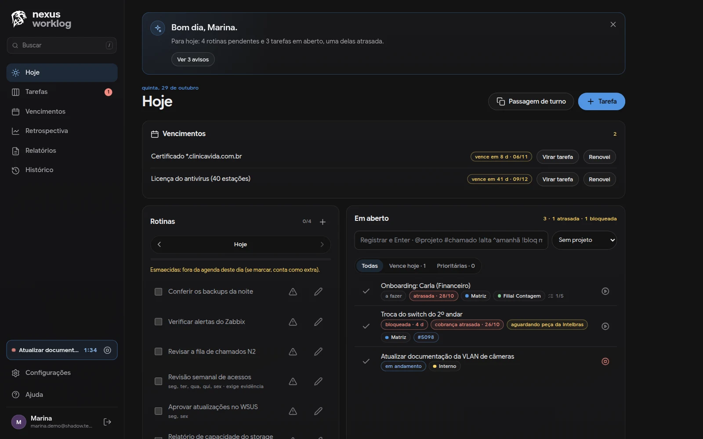
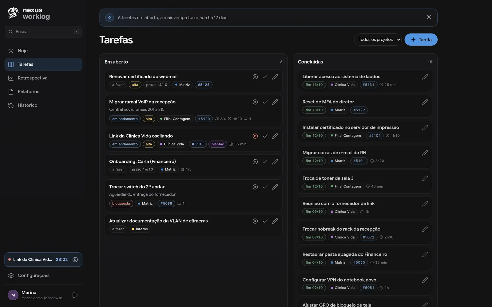
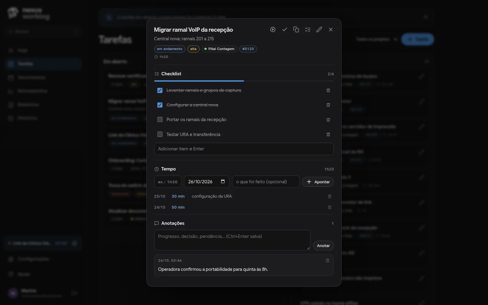
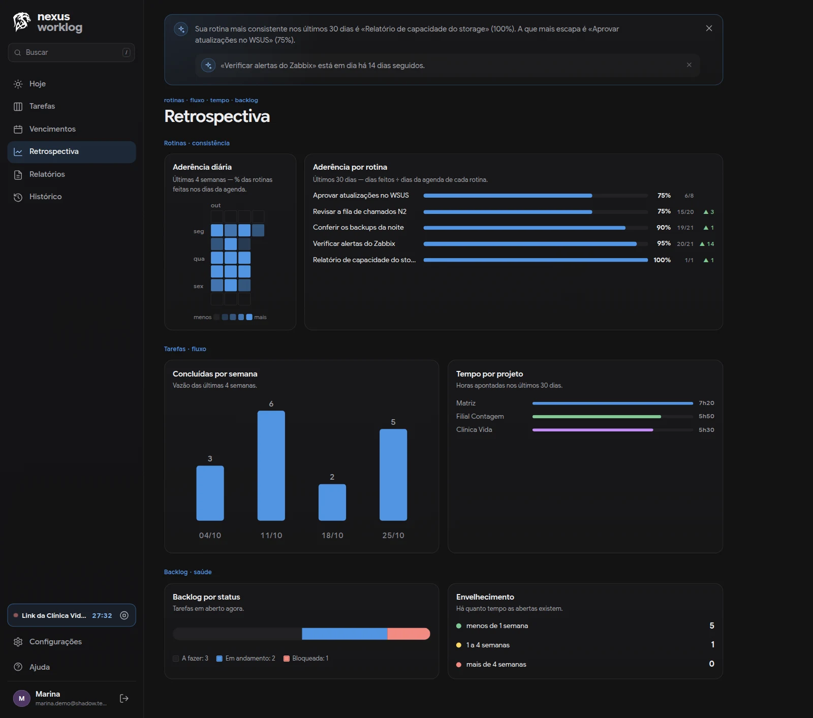
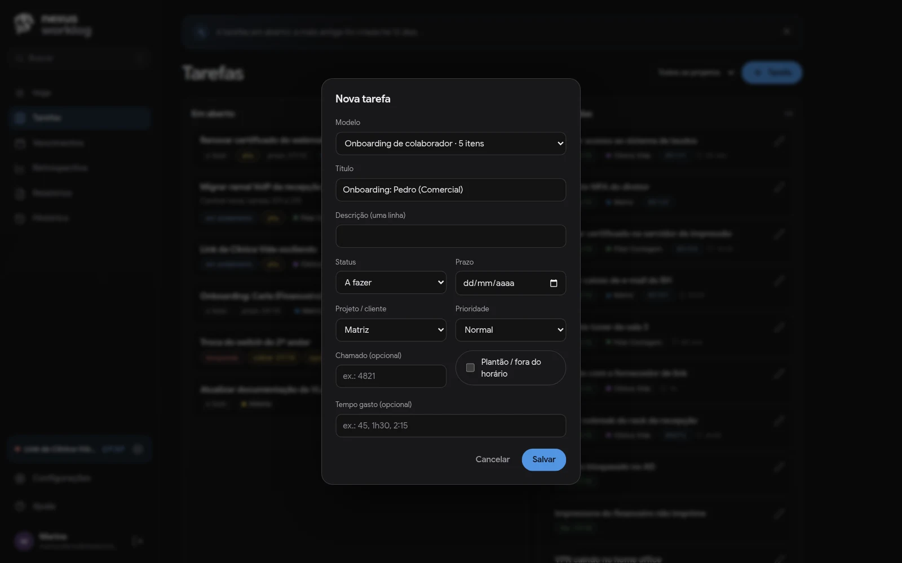
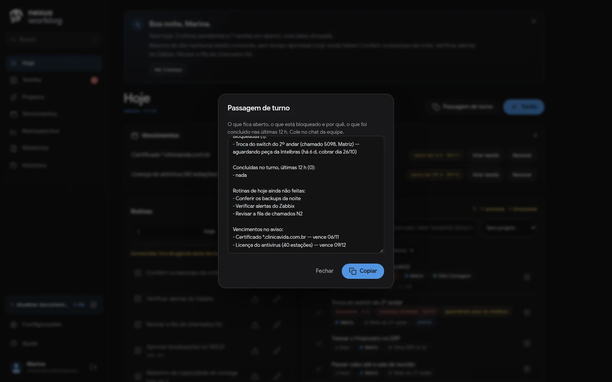
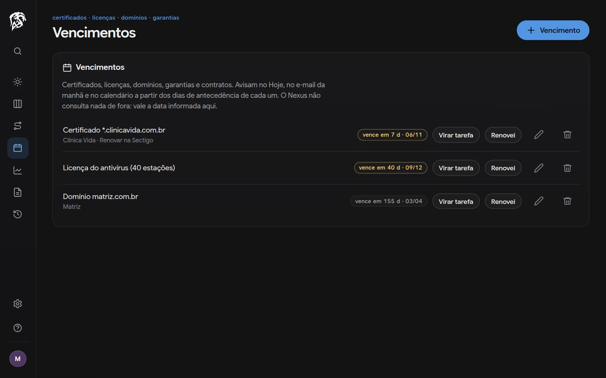
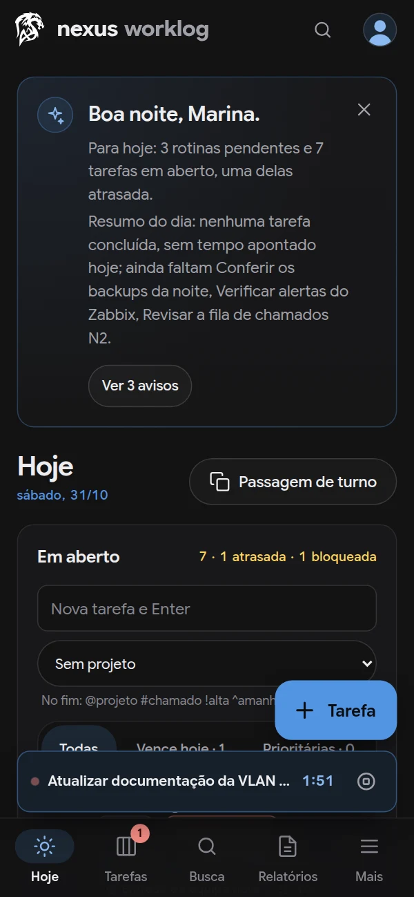
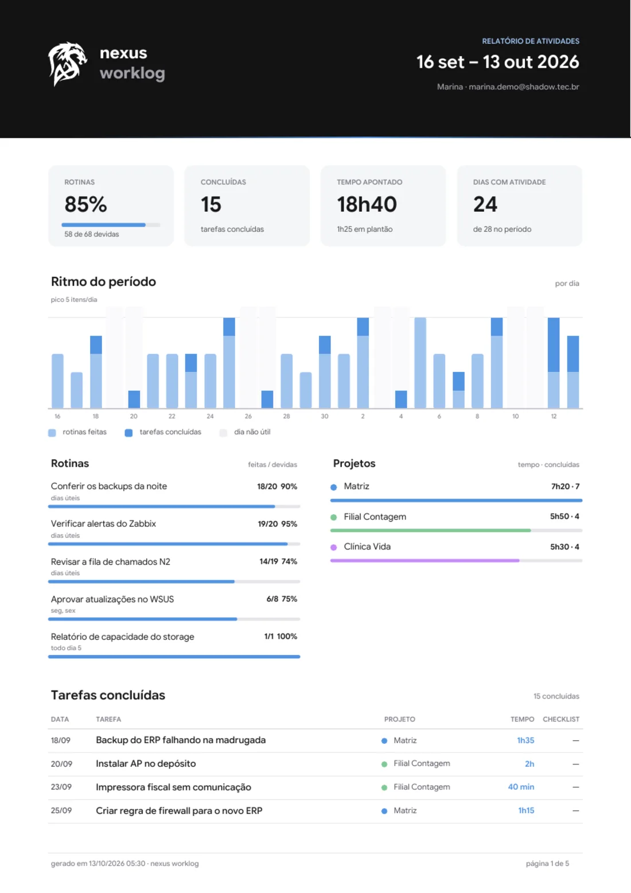

# Nexus Worklog

Registro do dia de trabalho para profissionais de TI — suporte, infraestrutura,
redes, segurança, desenvolvimento — e para quem precisa do relatório deles.
Multiusuário, auto-hospedado, sem frameworks JS nem passo de build.
Prioridades: **simples > seguro > funcional > elegante**.

Cada pessoa vê **apenas** os próprios dados. As contas são criadas pelo
**admin** (convite com senha temporária); não há cadastro público. Papéis
acumuláveis, dados em **Admin › Permissões**: **Usuário** (o próprio registro),
**Admin** (contas, permissões, configurações), **Atribuidor de tarefas** (manda
tarefas a quem aceitou receber) e **Visualizador de tarefas** (consulta, só
para leitura, o quadro, a retrospectiva e os relatórios de cada pessoa).

**Manual de uso, tela por tela:** [shadow.tec.br/nexus-manual](https://shadow.tec.br/nexus-manual.html).

## O que faz

- **Hoje** — o dia em um olhar, com um **assistente**: saudação, o que está
  pra hoje, o que saiu ontem, o resumo do dia e por onde começar. Avisa tarefa
  bloqueada há dias, prazo de amanhã e tempo esquecido, e copia o texto da
  daily. Cada aviso tem o próprio X; tudo é calculado a partir dos registros da
  pessoa, sem IA chamada a cada tela. As abertas filtram por "vence hoje"
  (com as atrasadas) ou "prioritárias", e o resumo da semana volta semana a
  semana, cada uma comparada com a anterior. No primeiro acesso, um **tour
  guiado** configura o essencial (nome, dias úteis, projetos, projeto padrão,
  rotinas) e mostra a tela; a Ajuda reabre.
- **Projetos e objetivos** — cada projeto tem objetivos (as demandas
  principais) em ordem de execução, cada um com as suas tarefas, também em
  ordem; arrasta para reordenar (no celular, pelo ⋮). Progresso e status do
  objetivo saem das tarefas; o que não tem objetivo fica em "Sem objetivo".
  O projeto tem descrição opcional; nome de projeto e título de objetivo não
  se repetem (sem diferenciar maiúsculas e acentos).
- **Rotinas** — verificações que se repetem (backups, alertas, fila…), com agenda:
  dias úteis, dias da semana, mensal (inclui "último dia") ou a cada N dias.
  Marcação até 7 dias para trás; feito fora da agenda conta como *extra*.
- **Tarefas** — status, prioridade, prazo, projeto/cliente (uma tarefa pode
  atender **mais de um projeto**: aparece em cada um, com o tempo inteiro em
  cada um; e há um **projeto padrão** por pessoa para o que é criado sem projeto), checklist,
  anotações e apontamento de tempo; **cronômetro** (um por pessoa, vale em
  qualquer aparelho); **número do chamado** (GLPI, TomTicket, Jira…) que vira
  link; **plantão** fora do horário, com o tempo separado no relatório; e
  **modelos** de tarefa com checklist pronto. Lançamento **retroativo** (criada e
  concluída em datas passadas, até um limite configurável pelo admin; padrão 60
  dias).
- **Passagem de turno e impedimentos** — tarefa bloqueada guarda o que se
  aguarda e há quantos dias; um clique monta o texto da passagem de turno
  (aberto, bloqueado e por quê, concluído nas últimas 12 h, plantão). Rotina marcada aceita uma
  **evidência** curta ("backup OK, 2,1 TB"), que vai para o PDF — e pode ser
  exigida por rotina. Impedimento parado há dias vira lembrete com "Cobrei", ou
  com um dia combinado para cobrar (no Hoje, no calendário e no e-mail da manhã).
  CSV de plantão (horas do mês) e CSV de rotinas e evidências (auditoria). Registro rápido
  entende `@projeto #chamado !plantão !alta ^amanhã !bloq motivo — 45min` (dois `@`, dois projetos); o detalhe da tarefa copia um resumo pronto para o chamado ou o cliente.
- **Vencimentos e base de conhecimento** — certificados, licenças, domínios e
  garantias avisam com antecedência (Hoje, e-mail da manhã, calendário); ao
  concluir, "como resolveu?" vira texto que a busca encontra — e a tarefa nova
  com título parecido já mostra "já resolvido antes".
- **Atribuição** — quem aceita (Configurações › Conta) recebe tarefas de um
  atribuidor pelo app ou pela IA, com aviso por e-mail; a tarefa passa a ser
  dela, e quem atribuiu acompanha o status e recebe um e-mail quando ela é concluída.
- **Relatórios** — PDF por período, por projeto ou do projeto inteiro, em
  estilo editorial: o período em texto corrido, os números, o ritmo, a
  **matriz de rotinas** (um ponto por dia) e o diário. Pode ir toda segunda
  anexado ao resumo semanal por e-mail, com cópia opcional (gestor, cliente).
  Exportação em CSV (planilha) e JSON (backup).
- **Retrospectiva** (aderência das rotinas, vazão, tempo por projeto, backlog),
  **histórico com desfazer**, **busca** sem acento (inclusive por `#chamado`),
  **feed de calendário (ICS)**, **avisos por e-mail** (opt-in), **lembrete** no
  app depois de X minutos sem registro, **atalhos de teclado** (`n`, `/`, `s`,
  `?`…), perfil com nome e foto e **identidade visual** configurável pelo admin.
- **Contas** — com e-mail configurado, o admin convida por **link** (7 dias,
  uso único; a pessoa cria a senha e já entra) e o login tem **esqueci a
  senha** (link de 1 hora). Sem e-mail, senha temporária trocada no 1º acesso.
- **IA** — chaves de API e servidor **MCP** (`/mcp`): a IA registra, anota,
  aponta e cronometra o que você contar, com tudo marcado no histórico pelo nome
  da chave. Comandos prontos para o resumo da semana e para a daily; `get_week`
  traz semanas passadas. Para
  lançar o que já aconteceu: `created_at`/`completed_at`, `external_ref` (não
  duplica) e `list_tasks` por período. A IA também monta projetos:
  `create_project`, `update_project` (arquiva, não exclui), `create_objective`
  (com posição), `update_objective` e `reorder_objectives` (a lista inteira; a
  ordem anterior fica no histórico, com desfazer). Nome ou título repetido
  devolve o que já existe; o status do objetivo continua automático. A IA não
  exclui tarefa, projeto nem objetivo.

## Telas

Capturas de uma conta de demonstração, com dados fictícios.


*Hoje — o assistente resume o dia e o anterior e sugere por onde começar, com avisos de prazo, tarefa bloqueada e tempo esquecido. Abaixo, os vencimentos no aviso, as rotinas e o registro rápido; no topo, a passagem de turno.*


*Tarefas — o número do chamado vira link, o plantão aparece em roxo, a bloqueada mostra o que aguarda e quando cobrar, e o cronômetro roda no menu.*


*Detalhe da tarefa — checklist, apontamentos de tempo e anotações num lugar só.*


*Retrospectiva — aderência de cada rotina, vazão por semana, tempo por cliente e saúde do backlog, com uma leitura do assistente no topo.*


*Modelos — escolhe o modelo no “+ Tarefa” e o checklist vem junto.*


*Passagem de turno — um clique monta o texto pra quem assume.*


*Vencimentos — quantos dias faltam; “Virar tarefa” cria a renovação e “Renovei” informa a nova data.*

<p>
  
  
</p>

*No celular, o mesmo assistente e o cronômetro acima da barra. Ao lado, a primeira página do relatório em PDF: indicadores, ritmo do período, rotinas, projetos e tarefas, com o plantão separado.*

## Arquitetura

```
Internet ──► cloudflared (host) ──► web (nginx) ──► backend (FastAPI) ──► db (Postgres)
             systemd, sem portas    127.0.0.1:PORT      │                 rede interna,
             abertas na VM          estático + /api    regras, PDF,       porta não exposta
                                    + /mcp + headers   e-mail
```

- **db** — PostgreSQL 16, volume nomeado, sem porta no host.
- **backend** — FastAPI + psycopg3, um processo; aplica `backend/sql/*.sql`
  (idempotentes, só aditivos) a cada início e roda o agendador de avisos.
- **web** — nginx: frontend estático, proxy de `/api/` e `/mcp`, CSP estrita.
- **cloudflared** — no host (systemd), fora do compose: a única exposição.

Frontend: HTML/CSS/JS puro (módulos ES), tema escuro, fonte Google Sans
Flex self-hosted (OFL). PDF com fpdf2 e a mesma fonte.

## Setup

Pré-requisitos: Docker + Docker Compose.

```bash
git clone https://github.com/jeffinshadow/nexus-worklog
cd nexus-worklog
```

1. `cp .env.example .env` (o `.env` **nunca** vai para o git) e preencha:
   - `SECRET_KEY` (32+ caracteres; menos que isso o backend não sobe):
     `python -c "import secrets; print(secrets.token_urlsafe(64))"`
   - `POSTGRES_PASSWORD` (o mesmo valor dentro de `DATABASE_URL`)
   - `ADMIN_EMAIL` / `ADMIN_INITIAL_PASSWORD`
   - sem HTTPS (teste local): `COOKIE_SECURE=false`
   - opcional, avisos por e-mail: `SMTP_HOST`, `SMTP_PORT` (465 = TLS, 587 =
     STARTTLS), `SMTP_USER`, `SMTP_PASSWORD`, `MAIL_FROM`, `APP_URL`
2. `docker compose up -d --build` — o nginx fica em `127.0.0.1:${WEB_PORT}`.
3. Entre com o admin: a troca de senha é obrigatória no primeiro acesso.
   Depois, **Admin › Novo usuário** cria as contas.

Desenvolvimento com e-mail falso: `docker-compose.mailpit.yml` (instruções no
próprio arquivo).

### Testes

```bash
docker compose -f docker-compose.test.yml run --rm --build tests
```

Postgres descartável (tmpfs), projeto compose separado — nunca encosta nos dados reais.

Testes de ponta a ponta no navegador (tour, convite e senha por e-mail, PDFs),
contra a homologação: veja [`tools/e2e/README.md`](tools/e2e/README.md).

## Deploy

`./deploy.sh` na VM: confere o `.env`, faz `pg_dump` verificado do banco, `git
pull --ff-only`, rebuild e smoke test (`--install` prepara uma VM Debian/Ubuntu
limpa). O túnel: `cloudflared` como serviço systemd com o token em
`/etc/cloudflared/<nome>.env` (root, 600), *public hostname* →
`http://localhost:${WEB_PORT}`. Cloudflare Access na frente é opcional (defesa
em profundidade).

**O banco de produção é preservado**: migrações só adicionam; nunca
`docker compose down -v`. O nome da pasta vira o nome do projeto do compose e,
com ele, o do volume do banco: mantenha a mesma pasta entre deploys. Se precisar
renomeá-la, fixe antes `COMPOSE_PROJECT_NAME` no `.env` com o nome antigo, ou o
Nexus sobe com um banco vazio (o antigo continua no volume de antes).

**Vigia de saúde** (opcional): `tools/vigia.sh` com o timer do systemd
(`tools/nexus-vigia.service` e `.timer`, instruções no arquivo) confere a cada 5
minutos o healthcheck dos containers, reinicia o que estiver *unhealthy* e manda
um e-mail pelo SMTP do próprio Nexus (`ALERT_EMAIL` ou `ADMIN_EMAIL`), uma vez por
incidente e outra quando volta. Logs com rotação (10 MB × 5 por serviço).

## Segurança (resumo)

- **Senhas** Argon2id (perfil OWASP, no máximo 2 cálculos simultâneos — sob
  carga responde 503 em vez de travar), mínimo 10 caracteres; login limitado
  por IP (todas as tentativas; IPv6 por /64) e por e-mail (só as falhas, que
  vão para o log); troca de senha limitada e diferente da atual. Links de
  convite e de senha nova: uso único, só o HMAC no banco, o token no `#` da
  URL (fora dos logs); "esqueci a senha" responde igual com ou sem conta e tem
  limite por IP e por e-mail.
- **Sessão** server-side: o banco guarda só o HMAC do token; cookie
  `__Host-session` (`HttpOnly; Secure; SameSite=Strict`), prazo fixo
  (`SESSION_TTL_DAYS`). Histórico guardado por 180 dias.
  **CSRF** por header em toda mutação.
- **Chaves de API** (`nxs_…`) e **link do calendário** (`nxc_…`): só o HMAC no
  banco, revogáveis; trocar a senha (ou o reset pelo admin) revoga ambos. Chave nunca
  acessa rotas de admin, de visualizador, chaves, calendário ou avisos; atribuir
  por chave exige o papel de atribuidor e escopo de escrita.
- **Isolamento**: toda consulta filtra por `user_id`; permissões em
  `backend/app/deps.py`.
- **nginx**: CSP sem inline, HSTS, `nosniff`, `DENY` em frames; o link do
  calendário não vai para o log. Logo enviado validado pelo conteúdo e servido
  em sandbox.
- **Seus dados (LGPD)**: cada pessoa exporta tudo em JSON ou CSV (Relatórios) e
  exclui a própria conta em Configurações › Conta (com a senha); o admin também
  exclui uma conta (Admin › Usuários, confirmando o e-mail). Tarefas, rotinas,
  tempo, anotações, chaves e histórico vão junto; ficam só o e-mail e as contagens
  no histórico de quem excluiu (180 dias). O último admin não sai.
- **Sem rastreamento**: só o cookie de sessão; e-mails sem pixel nem links
  redirecionados; CSV exportado neutraliza fórmulas.

## Estrutura

```
backend/app/       rotas (routers/), regras (services.py), PDF, e-mail, MCP
backend/sql/       migrações numeradas (o modelo de dados está aqui)
backend/tests/     suíte (pytest + Postgres real)
web/static/        index.html, login.html, js/ (um módulo por tela), css/
docs/API.md        referência da API e do MCP (o Swagger fica desligado)
```

Fuso da aplicação em `APP_TZ` (define "hoje", semana — que começa no
domingo — e mês, no backend e na interface).
