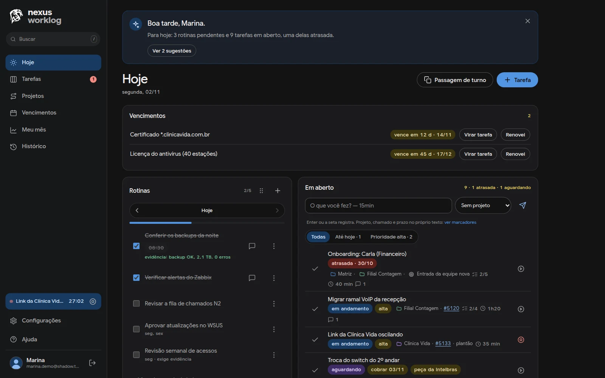
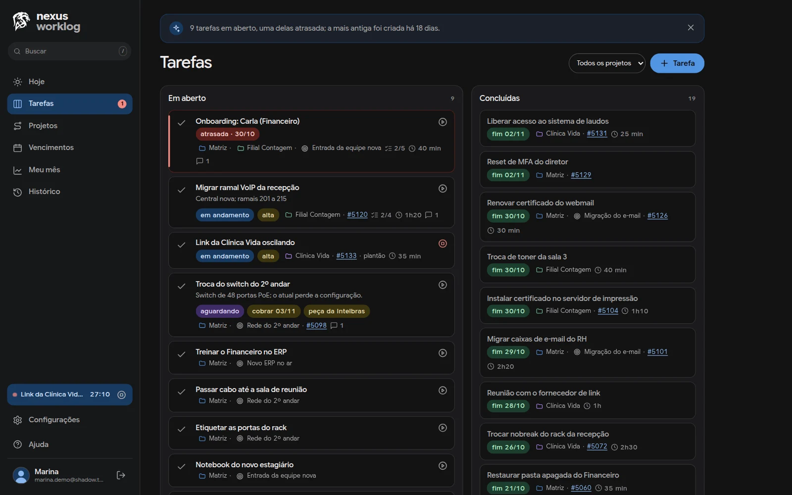
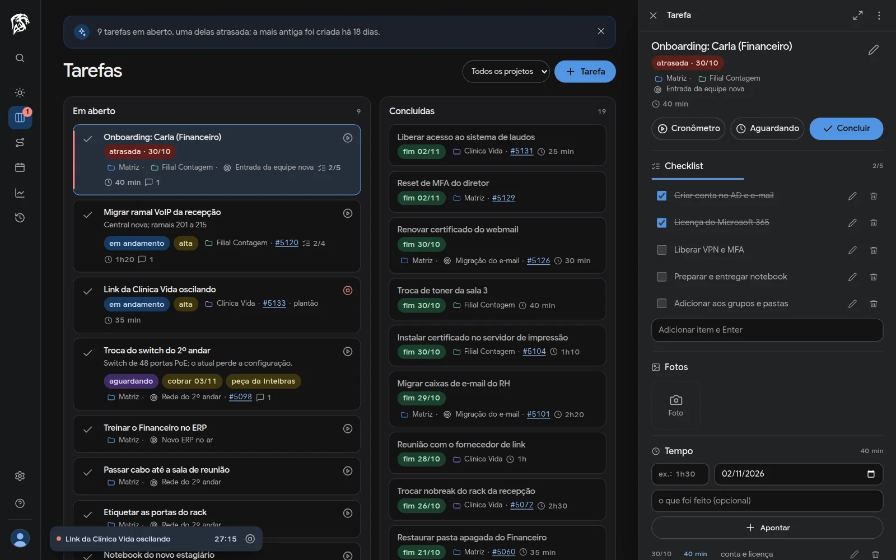
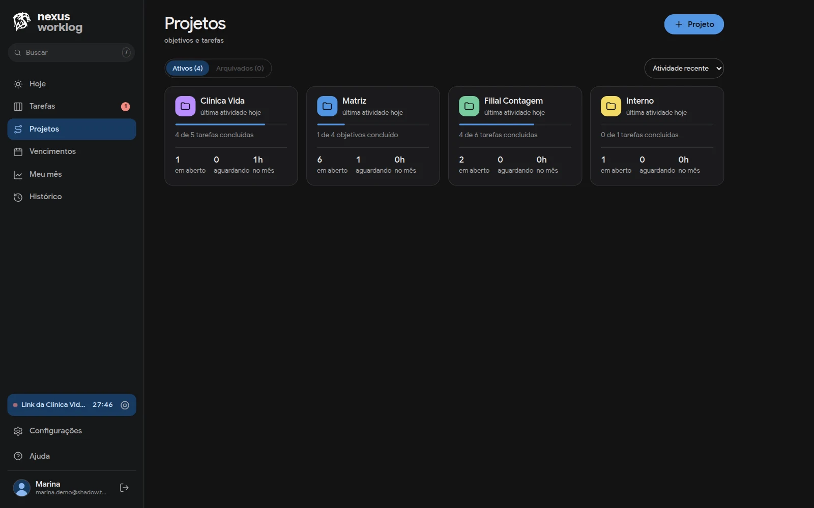
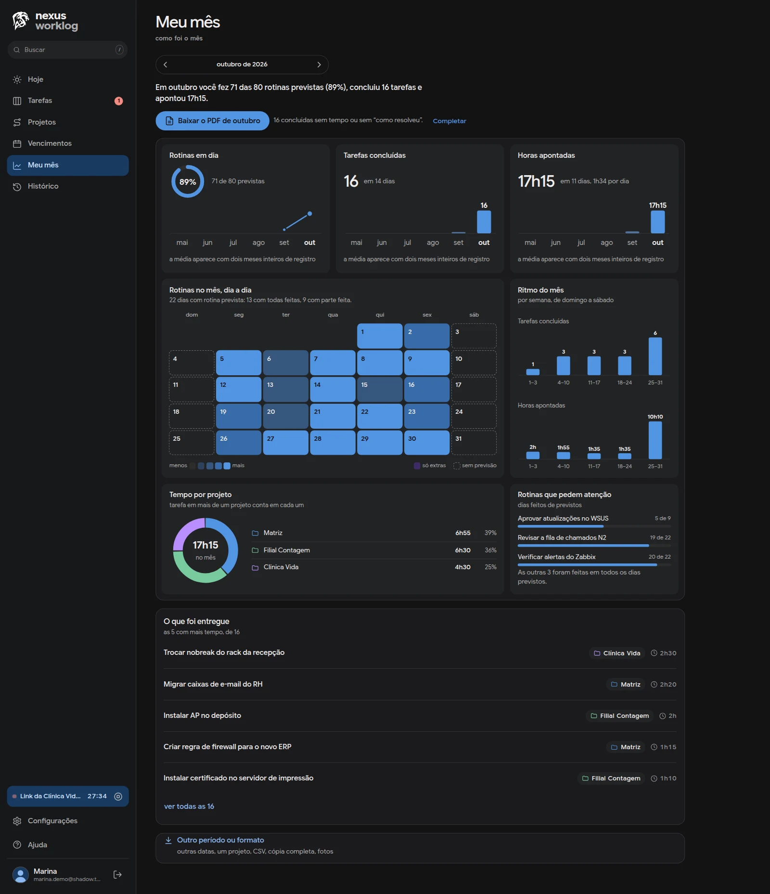
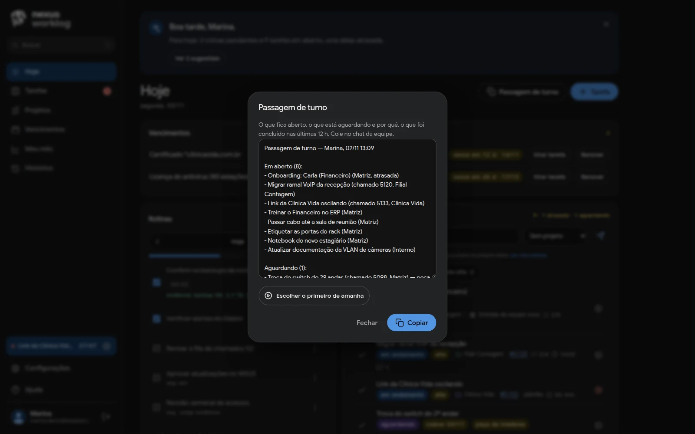
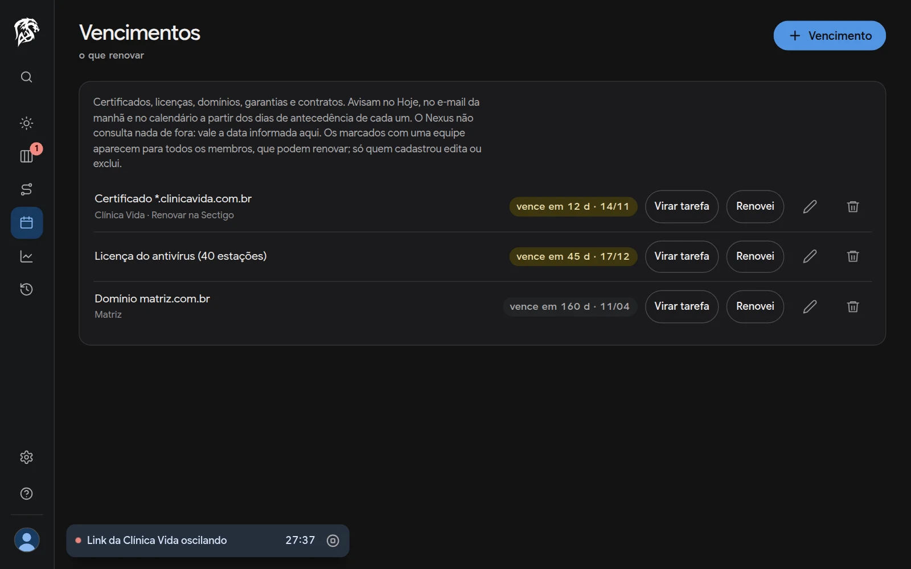
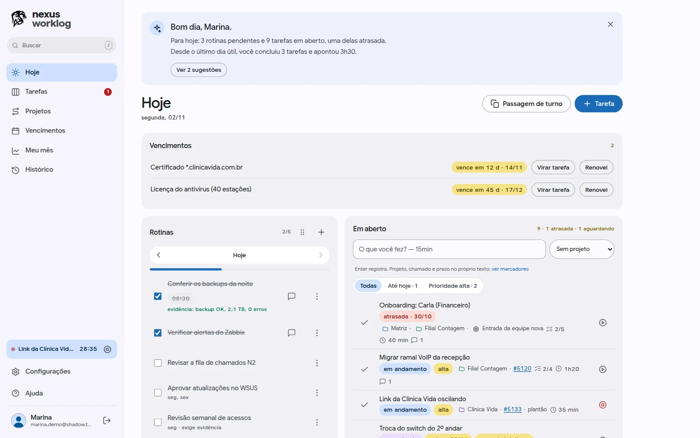
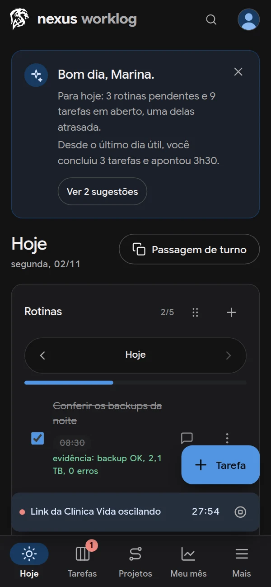
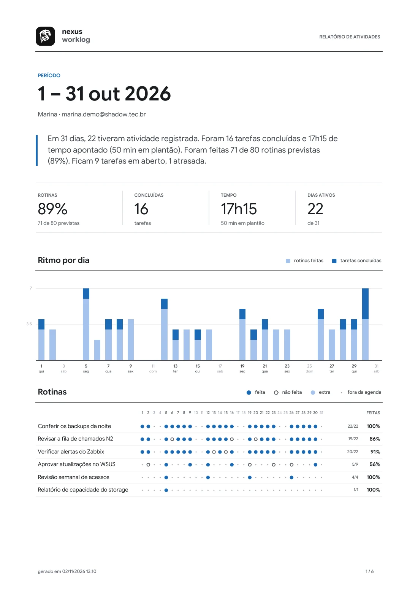

# Nexus Worklog

Registro do dia de trabalho para quem faz suporte, em qualquer área — TI,
infraestrutura, redes, manutenção, atendimento técnico — e para quem precisa
do relatório deles. O foco é ajudar cada pessoa a organizar a própria rotina.
Multiusuário, auto-hospedado, sem frameworks JS nem passo de build.
Prioridades: **simples > seguro > funcional > elegante**.

**Versão 2.0.0** (SemVer; o número fica em `backend/app/version.py`). O que mudou em cada versão:
[`CHANGELOG.md`](CHANGELOG.md). Para quem hospeda e administra:
[`docs/ADMIN.md`](docs/ADMIN.md) (instalação, variáveis, e-mail e push, backup e restauração, atualização, opções do Admin).

A base de todas as decisões do projeto está em [docs/CONSTITUICAO.md](docs/CONSTITUICAO.md).

Cada pessoa vê **apenas** os próprios dados. As contas são criadas pelo
**admin** (convite por link, ou senha temporária sem e-mail); não há cadastro público. Papéis
acumuláveis, dados em **Admin > Contas > ⋮ > Papéis…**: **Usuário** (o próprio registro),
**Admin** (convites, contas, papéis, configurações; não vê o registro de ninguém), **Manda tarefas** (libera, na tela Equipe, o
botão Atribuir tarefa e a lista Tarefas que atribuí: atribui tarefas a quem aceitou receber) e **Vê a equipe** (libera a tela Equipe: consulta, só
para leitura, o quadro, a retrospectiva, os relatórios, as horas e as fotos de
quem **aceitou** em Configurações > Conta; contas novas começam sem o aceite, e
os Papéis… de cada conta mostram quem liberou). O admin também tem o próprio registro;
em Admin > Contas ele vê quando cada conta foi criada e o **último acesso**, filtra
por papel e situação (ativa, convite pendente, bloqueada), reenvia ou **cancela um
convite** ainda não aceito, redefine a senha (com e-mail configurado, manda o **link de
nova senha** em vez de uma senha para repassar), **bloqueia o acesso** (a pessoa sai de
todos os aparelhos, chaves e passkeys param, os dados ficam; Redefinir senha libera) ou
exclui a conta de vez; ao bloquear ou excluir, pode **passar as tarefas abertas** para
outra pessoa. No convite, o admin já informa o nome e escolhe os papéis; quem ganha
ou perde um papel depois é avisado no app (e por e-mail).

**Equipes** (Admin > Equipes): uma pessoa pode estar em várias. Sem nenhuma equipe, o
Nexus funciona como organizador pessoal; com equipes, "Vê a equipe" e "Manda tarefas"
valem só entre quem está na mesma equipe (no app, na API, no MCP, no CSV e no PDF), e as
opções de Para empresas, só para quem está em alguma. A Equipe ganha um seletor de equipe,
o Atribuir agrupa por equipe, Contas mostra e filtra por equipe, o convite já vincula
equipes e a Conta mostra as da pessoa. O **admin master** (o primeiro admin) vê e atribui
para todos quando liga os próprios papéis, com o que abre no log de admin; só ele passa
o papel adiante, com senha e código mandado ao e-mail.

**Para empresas e instituições** (Admin > Para empresas; tudo desligado por padrão,
porque o padrão é o organizador pessoal): **visibilidade da equipe** ("Cada pessoa
escolhe" ou "Visível para quem gerencia", em que quem tem o papel Vê a equipe vê todos e
a chave de aceite fica bloqueada, à vista, com o motivo; as escolhas de cada um ficam
guardadas), **receber tarefas atribuídas** ("Cada pessoa escolhe" ou "Todos recebem de
quem atribui", em que todo Usuário recebe tarefas de quem tem o papel Manda tarefas, com
a mesma chave bloqueada e as escolhas guardadas), **nome e e-mail definidos pela administração** (desligado, cada pessoa
troca os seus na Conta, e o e-mail novo só vale depois de confirmado por link) e
**"Solicitar convite" na tela de login** (desligado, só entra quem o admin convidar), o
**endereço do sistema de chamados para todos** (vazio, cada pessoa usa o seu) e o
**link da política de privacidade** (na tela de login, na Conta e no convite). Cada
mudança fica no histórico do admin. Toda conta nova faz o tour guiado no primeiro acesso.

**Manual de uso, tela por tela:** [shadow.tec.br/nexus-manual](https://shadow.tec.br/nexus-manual).

## O que faz

- **Hoje** — o dia em um olhar, com um **assistente**: saudação, o que está
  pra hoje, o que saiu ontem e por onde começar. Avisa cobrança do dia, prazo de amanhã e tempo
  esquecido (as sugestões); um só interruptor liga ou desliga as falas (Configurações). Cada
  aviso tem o próprio X; tudo é calculado a partir dos registros da
  pessoa, sem IA chamada a cada tela. As abertas filtram por "até hoje"
  (o que vence hoje e as atrasadas) ou "prioridade alta"; as rotinas fora da
  agenda do dia ficam recolhidas numa linha só. **Revisão da semana** guiada, em
  3 passos (o que fechou, com "como resolveu"; o que ficou, mudando só o que
  precisar: reagendar, aguardando ou concluir; o Primeiro amanhã, até 3), que
  termina com o texto da semana pronto para copiar; o assistente convida no
  último dia útil, uma vez. **Primeiro amanhã**: na Passagem de turno (o texto
  do dia) ou na revisão da semana, até 3 tarefas para começar o próximo dia útil; nesse
  dia elas abrem as abertas com o selo "primeiro hoje" e saem sozinhas depois
  (as prioridades da revisão da semana entram no mesmo lugar). No primeiro acesso, um **tour
  guiado** configura o essencial (nome, dias úteis, projetos, projeto padrão,
  rotinas, com um pacote da área se quiser) e mostra a tela; a Ajuda reabre.
- **Projetos e objetivos** — cada projeto tem objetivos (as demandas
  principais) em ordem de execução, cada um com as suas tarefas, também em
  ordem; arrasta para reordenar (no celular, pelo ⋮). Progresso e status do
  objetivo saem das tarefas; o que não tem objetivo fica em "Sem objetivo".
  O projeto tem descrição opcional e um **ícone** de uma biblioteca fixa
  (prédio, loja, clínica, servidor, rede, elétrica… 24 no traço do app; sem
  escolha, a pasta), que aparece no cartão, no título e nas etiquetas das
  tarefas. O cartão mostra o progresso dos objetivos, em aberto · aguardando ·
  horas no mês e a última atividade (para ver o que está parado); a lista tem
  abas Ativos/Arquivados, ordem por atividade ou nome e busca. Ao **arquivar**,
  a pessoa escolhe o que fazer com as tarefas em aberto: manter, concluir ou
  mover para outro projeto. Nome de projeto e título de objetivo não se
  repetem (sem diferenciar maiúsculas e acentos).
- **Rotinas** — verificações que se repetem (backups, alertas, fila…), com agenda:
  dias úteis, dias da semana, mensal (inclui "último dia"), a cada N dias ou
  **N dias depois da última vez** (trocar o filtro 30 dias depois da última
  troca: a data se move quando se marca; mudar o N mantém a última vez). Marcação até 7 dias para trás; feito
  fora da agenda conta como *extra*. **Pausar até uma data** (férias, folga,
  prédio fechado): nesses dias a rotina não conta como falta nem lembra, e
  volta sozinha; a pausa vale de hoje em diante, sem mexer no passado.
  Para começar, **pacotes por área** (Manutenção predial, Suporte de TI,
  Atendimento e recepção, Redes e campo, Segurança da informação): num toque,
  o projeto da área com ícone e as rotinas com agenda e horário (ronda às 8h,
  extintores todo dia 1, atualizações às sextas…); a pessoa marca os passos antes
  e edita tudo depois. Estão no tour, no + das rotinas e nas telas vazias; não
  duplicam o que já existe. A **ordem** das rotinas no Hoje é a da pessoa
  (setas ou arrastar, com desfazer). **Passos** opcionais (a ronda com casa de
  máquinas, bombas, gerador…, até 12): marcar mostra a lista, todos marcados;
  o que não foi feito vai para a evidência ("feita, exceto: gerador") e a
  rotina continua contando uma vez. A ronda do pacote predial já vem com passos.
- **Tarefas** — status, prioridade, prazo, projeto/cliente (uma tarefa pode
  atender **mais de um projeto**: aparece em cada um, com o tempo inteiro em
  cada um; e há um **projeto padrão** por pessoa para o que é criado sem projeto), checklist,
  anotações e apontamento de tempo; **cronômetro** (um por pessoa, vale em
  qualquer aparelho; trocou de tarefa por uma interrupção, ao parar ou concluir a
  interrupção ele oferece **voltar** para a que ficou parada); **lembrete com hora**
  ("Lembrete com hora": na hora, aviso na tela e notificação do aparelho com Concluir e
  Adiar 10 min; também pela IA e no calendário); **número do chamado** (GLPI, TomTicket, Jira…) que vira
  link; **plantão** fora do horário, com o tempo separado no relatório; e
  **Duplicar tarefa** e pacotes de rotina para repetir trabalho. Lançamento **retroativo** (criada e
  concluída em datas passadas, até 60 dias). Apontamento, anotação e item do checklist se **corrigem** no lugar
  (com desfazer; a anotação mantém a hora); concluída por engano, **Reabrir**;
  com o quadro filtrado por um projeto, a tarefa nova já vem nele.
- **Passagem de turno e espera** — tarefa marcada como aguardando guarda o
  quê (peça, cliente, aprovação) e há quantos dias; um clique monta o texto da passagem de turno
  (aberto, aguardando e por quê, concluído nas últimas 12 h, plantão). Rotina marcada aceita uma
  **evidência** curta ("backup OK, 2,1 TB"), que vai para o PDF — e pode ser
  exigida por rotina. Ao marcar uma tarefa como Aguardando, o "Dia para cobrar" já vem
  sugerido para 5 dias úteis à frente (muda ou limpa); no dia, o lembrete aparece no Hoje (com
  "Cobrei"), no calendário e no aviso da manhã.
  CSV de plantão (horas do mês) e CSV de rotinas e evidências (auditoria). Registro rápido
  entende `@projeto #chamado !plantão !alta ^amanhã ^15h !aguarda motivo — 45min` (dois `@`, dois projetos;
  `^15h`, `^amanhã 8h` = lembrete com hora); **colar uma lista** (uma por linha, do bloco de notas, WhatsApp ou planilha)
  vira várias tarefas, com prévia e um Desfazer para o lote; o detalhe da tarefa copia um resumo pronto para o chamado ou o cliente.
- **Vencimentos e base de conhecimento** — certificados, licenças, domínios e
  garantias avisam com antecedência (Hoje, e-mail da manhã, calendário) e podem
  ser compartilhados com uma equipe (todos os membros veem, renovam e viram
  tarefa na própria conta; só quem cadastrou edita); ao
  concluir, "como resolveu?" vira texto que a busca encontra — e a tarefa nova
  com título parecido já mostra "já resolvido antes".
- **Atribuição** — quem aceita (Configurações > Conta) recebe tarefas de um
  atribuidor pelo app ou pela IA, com aviso por e-mail; a tarefa passa a ser
  dela, e quem atribuiu acompanha o status e recebe um e-mail quando ela é concluída.
  A descrição aceita várias linhas. Enquanto está "a fazer" e sem nada registrado,
  quem atribuiu ainda corrige título, descrição, prazo e prioridade (só o que a pessoa não mudou) ou cancela (engano;
  só se ela não mexeu em nada); excluída ou cancelada, a linha continua em
  Tarefas que atribuí (na Equipe) com quem tirou e quando. Conta com acesso bloqueado não recebe.
  Quem recebeu pode **devolver** a tarefa com o motivo (no detalhe dela): sai da lista dela
  (desfazível pelo Histórico), e quem atribuiu é avisado (e-mail, push, Hoje e "Precisa de
  atenção") e atribui de novo — à mesma pessoa ou a outra, com o diálogo já preenchido — ou encerra.
  No Hoje de quem atribui, uma linha dispensável: "Das que você atribuiu: 2 concluídas, 1 devolvida".
- **Meu mês** — o mês num olhar, com um seletor só (‹ mês ›, o corrente por
  padrão): uma frase ("Em outubro você fez 50 das 81 rotinas previstas (62%),
  concluiu 20 tarefas e apontou 31h43") e o PDF; depois um **painel** num
  contêiner próprio (grade de 12 colunas; uma coluna no celular): rotinas em
  dia (anel + linha dos últimos 6 meses), tarefas concluídas e horas apontadas
  (número + barras dos 6 meses, o mês em destaque), cada um com uma palavra
  neutra que situa o mês na média da própria pessoa (acima / na média / abaixo,
  sem cor nem seta); o calendário do mês (domingo a sábado, cada dia pintado
  pela parte das rotinas feitas, como no GitHub; só extras em outro tom;
  pausado e futuro vazios); o ritmo por semana (tarefas e horas); o tempo por
  projeto (rosca com legenda em horas) e as rotinas que pedem atenção. Por
  fim, o que foi entregue (as 5 com mais tempo, com o "como resolveu", e "ver
  todas"). Os números são os mesmos do PDF, mês a mês. "Na média" = até 5
  pontos percentuais (rotinas) ou 15% (tarefas, horas; no mínimo 1 tarefa e 1
  hora) da média dos meses anteriores, com pelo menos 2 meses inteiros; no mês
  corrente, proporcional aos dias passados e só depois da primeira semana. Na
  Equipe aparecem o mês e o calendário, sem a tendência, a média e o ranking
  de rotinas (não é placar).
  **Baixar o PDF do mês** é a ação principal; antes dele, se alguma concluída do
  mês está sem tempo ou sem "como resolveu", uma lista curta deixa completar ali
  mesmo (15/30/60 min, uma linha do como resolveu) ou baixar assim mesmo. Em "Outro período ou formato"
  ficam o PDF de outras datas, por projeto ou do projeto inteiro, e as
  exportações. O PDF é editorial: o período em texto corrido, os números, o ritmo, a
  **matriz de rotinas** (um ponto por dia) e o diário. Pode ir toda segunda
  anexado ao resumo semanal por e-mail, com cópia opcional para quem acompanha o trabalho.
  Exportação em CSV (planilha, pelo período escolhido) e JSON (backup).
- **Equipe** (papéis Vê a equipe e Manda tarefas, numa tela só, sem abas): um painel para coordenar, não para comparar.
  Os números da equipe somados (rotinas em dia, tarefas concluídas, horas,
  aguardando) com os últimos 6 meses da equipe, "Precisa de atenção" (o que
  você atribuiu e foi devolvido ou parou, o que aguarda há mais tempo, os prazos próximos), o
  tempo por projeto e as pessoas em ordem alfabética (12 por página); tocar numa pessoa abre o
  mês e o quadro dela, só leitura. Sem ranking, média ou tendência de outra
  pessoa; só entra quem aceitou ser visto (`GET /api/viewer/team`). No topo:
  Atribuir tarefa (diálogo por cima da tela), Horas da equipe (CSV do período) e PDF de uma pessoa ou projeto.
  Logo abaixo do painel, Tarefas que atribuí (filtro Em aberto / Devolvidas / Concluídas, 15 por página).
  Quem só atribui tarefas vê só essa lista e o botão, sem números nem pessoas.
- **Histórico com desfazer**, **busca** sem acento (inclusive por `#chamado`),
  **feed de calendário (ICS)**, **avisos por e-mail** (opt-in), **lembrete** no
  app depois de X minutos sem registro, **atalhos de teclado** (`n`, `q`, `/`, `s`,
  `?`…), perfil com nome e foto e **identidade visual** configurável pelo admin.
- **App instalável** (PWA, sem loja) — no celular e no computador, com convite
  para instalar (no iPhone, o passo a passo do Safari), **atalhos** no ícone
  (nova tarefa, registro rápido, tarefas), **compartilhar para o Nexus** (texto
  ou link de outro app vira uma nova tarefa preenchida) e o **número no ícone**
  (atrasadas + rotinas na hora). **Notificações do sistema** com o app fechado,
  por aparelho (Web Push padrão, criptografado, sem Firebase): rotina na hora
  com Marcar feita e Adiar (repete até marcar), cobranças e prazos de manhã (no mesmo horário do e-mail "Seu dia") e
  tarefa atribuída; opção de esconder os nomes na tela bloqueada.
- **Fotos** — na tarefa e como evidência da rotina: câmera no celular, print
  colado (Ctrl+V) ou arrastado no computador, ou compartilhada de outro app.
  Reduzidas no aparelho (1600 px, sem EXIF/GPS), com miniatura, excluir com
  desfazer, cota por pessoa e exportação em .zip.
- **Sem sinal** — o app abre com as telas da última visita (avisando de que
  hora são) e guarda no aparelho o que for feito: registrar, concluir, anotar,
  marcar rotina, fotos e o cronômetro, com a hora em que aconteceu. Com sinal, o
  app já deixa tudo pronto sozinho (ao abrir e, no máximo, a cada 30 min, se
  houver espaço): guarda o detalhe das tarefas em aberto (checklist e
  anotações, até 60), e a barra de sem conexão diz de que hora; uma tarefa
  nunca aberta com sinal abre com o que havia nas listas e aceita anotação, foto
  e conclusão. Na volta da conexão, vai sozinho e na ordem, sem duplicar (nem
  as fotos); o que for recusado fica com o texto inteiro para copiar. Sair limpa
  tudo do aparelho.
- **Tema claro e escuro** (Material 3) — segue o aparelho ou fica fixo pela
  conta, com contraste AA medido em todo texto; no celular, controles com área
  de toque de pelo menos 44 px.
- **Pedido de convite** — opcional (o admin liga em Para empresas): com e-mail
  configurado, quem não tem conta pede pela tela de entrar; o admin recebe e-mail
  e notificação e convida ou recusa em Admin. Até 20 pedidos por dia.
- **Passkeys** — entrar sem senha, com a digital, o rosto, o Windows Hello ou
  uma chave física (WebAuthn); a senha continua valendo. **Sair dos outros
  aparelhos** sem trocar a senha (celular perdido, computador emprestado).
- **Contas** — com e-mail configurado, o admin convida por **link** (7 dias,
  uso único; a pessoa cria a senha e já entra) e o login tem **esqueci a
  senha** (link de 1 hora). Sem e-mail, senha temporária trocada no 1º acesso.
- **IA** — chaves de API e servidor **MCP** (`/mcp`): a IA registra, anota,
  aponta e cronometra o que você contar, com tudo marcado no histórico pelo nome
  da chave. Chave **só registrar** (cria, anota, aponta, marca e conclui; não
  altera nem exclui, nem pela API REST) e **O que fez** em cada chave (o
  Histórico só com as ações dela). Comandos prontos para planejar e fechar o dia,
  o resumo de um projeto, o resumo da semana e a daily; `get_week`
  traz semanas passadas e `get_period`, qualquer período (tempo por projeto). Para
  lançar o que já aconteceu: `created_at`/`completed_at`, `external_ref` (não
  duplica) e `list_tasks` por período. A IA também monta projetos:
  `create_project`, `update_project` (arquiva, não exclui), `create_objective`
  (com posição), `update_objective` e `reorder_objectives` (a lista inteira; a
  ordem anterior fica no histórico, com desfazer). Nome ou título repetido
  devolve o que já existe; o status do objetivo continua automático. Cria
  rotinas (`create_recurring`, com passos) e aplica pacotes por área (`list_routine_packs`,
  `apply_routine_pack`); "me lembra às 15h de ligar pra Ana" vira lembrete com hora
  (`remind_at` em `create_task`/`update_task`). A IA não exclui tarefa, rotina, projeto nem
  objetivo. Liga no Claude Code, Cursor, Claude Desktop e Gemini CLI
  (docs/API.md); ChatGPT e claude.ai na web ainda não (exigem OAuth).
- **Integração** — API REST aberta, sem conector para produto específico:
  `external_ref` em tarefas, projetos, anotações e tempo (repetir não duplica),
  feed de mudanças (`/api/history?after=`) e webhooks de saída assinados
  (HMAC-SHA256), com os eventos numa lista para marcar, edição sem trocar o
  segredo e botão Testar. Também avisos de **agenda** (dia de cobrar, hora da
  rotina, vencimento no aviso), uma vez cada, no feed e no webhook. Chave de API vencida se renova sem trocar de valor;
  as vencidas e revogadas ficam recolhidas. Contrato em [`docs/openapi.json`](docs/openapi.json);
  receitas `curl` em [`docs/API.md`](docs/API.md#integração-passo-a-passo) e, prontas,
  aviso no Telegram, e-mail e planilha em [`docs/API.md`](docs/API.md#receitas-avisos-e-planilha).

## Telas

Capturas de uma conta de demonstração, com dados fictícios.


*Hoje — o assistente resume o dia e o anterior e sugere por onde começar, com avisos de prazo, tarefa aguardando e tempo esquecido. Abaixo, os vencimentos no aviso, as rotinas e o registro rápido; no topo, a passagem de turno.*


*Tarefas — o número do chamado vira link, o plantão aparece em roxo, a que está aguardando mostra o quê e quando cobrar, e o cronômetro roda no menu.*


*Detalhe da tarefa — checklist, fotos (câmera, print colado ou arrastado), apontamentos de tempo e anotações num lugar só; o botão no topo expande para ler com calma. No menu da tarefa, “Duplicar tarefa” cria outra igual (título, descrição, projetos, objetivo, prioridade e checklist desmarcado), sem tempo, fotos, anotações nem datas.*


*Projetos — cada um com o ícone na sua cor, o progresso dos objetivos, o que está em aberto ou aguardando, as horas do mês e a última atividade; abas Ativos e Arquivados, ordem por atividade ou nome. Aberto, o projeto mostra os números, os próximos prazos e os objetivos em ordem de execução.*


*Meu mês — o mês numa frase e o PDF num botão; o painel com rotinas, tarefas e horas dos últimos 6 meses, o calendário do mês pintado pelas rotinas feitas, o ritmo por semana, o tempo por projeto e o que foi entregue.*



*Passagem de turno — um clique monta o texto pra quem assume.*


*Vencimentos — quantos dias faltam; “Virar tarefa” cria a renovação e “Renovei” informa a nova data.*


*Tema claro — segue o tema do aparelho por padrão; em Configurações > Conta > Aparência, a pessoa fixa claro ou escuro. Contraste medido em todo texto (WCAG AA).*

<p>
  
  
</p>

*No celular, a barra do topo com a marca, o mesmo assistente e o cronômetro acima da barra de baixo; instala como app, avisa com o app fechado e funciona sem sinal. Ao lado, a primeira página do relatório em PDF: indicadores, ritmo do período, rotinas, projetos e tarefas, com o plantão separado.*

## Arquitetura

```
Internet ──► cloudflared (host) ──► web (nginx) ──► backend (FastAPI) ──► db (Postgres)
             systemd, sem portas    127.0.0.1:PORT      │                 rede interna,
             abertas na VM          estático + /api    regras, PDF,       porta não exposta
                                    + /mcp + headers   e-mail
```

- **db** — PostgreSQL 16, volume nomeado, sem porta no host.
- **backend** — FastAPI + psycopg3, um processo; aplica `backend/sql/*.sql`
  (idempotentes, só aditivos) a cada início e roda o agendador de avisos.
- **web** — nginx: frontend estático, proxy de `/api/` e `/mcp`, CSP estrita.
- **cloudflared** — no host (systemd), fora do compose: a única exposição.

Frontend: HTML/CSS/JS puro (módulos ES), tema escuro, fonte Google Sans
Flex self-hosted (OFL). PDF com fpdf2 e a mesma fonte.

## Setup

Pré-requisitos: Docker + Docker Compose.

```bash
git clone https://github.com/jeffinshadow/nexus-worklog
cd nexus-worklog
```

1. `cp .env.example .env` (o `.env` **nunca** vai para o git) e preencha:
   - `SECRET_KEY` (32+ caracteres; menos que isso o backend não sobe):
     `python -c "import secrets; print(secrets.token_urlsafe(64))"`
   - `POSTGRES_PASSWORD` (o mesmo valor dentro de `DATABASE_URL`)
   - `ADMIN_EMAIL` / `ADMIN_INITIAL_PASSWORD`
   - sem HTTPS (teste local): `COOKIE_SECURE=false`
   - opcional, avisos por e-mail: `SMTP_HOST`, `SMTP_PORT` (465 = TLS, 587 =
     STARTTLS), `SMTP_USER`, `SMTP_PASSWORD`, `MAIL_FROM`, `APP_URL`
2. `docker compose up -d --build` — o nginx fica em `127.0.0.1:${WEB_PORT}`.
3. Entre com o admin: a troca de senha é obrigatória no primeiro acesso.
   Depois, **Admin > Contas > Convidar pessoa** cria as contas (nome e papéis já no convite). Guia completo de
   administração, variáveis e operação: [`docs/ADMIN.md`](docs/ADMIN.md).

Desenvolvimento com e-mail falso: `docker-compose.mailpit.yml` (instruções no
próprio arquivo).

### Testes

```bash
docker compose -f docker-compose.test.yml run --rm --build tests
```

Postgres descartável (tmpfs), projeto compose separado — nunca encosta nos dados reais.

Testes de ponta a ponta no navegador (tour, convite e senha por e-mail, PDFs),
contra a homologação: veja [`tools/e2e/README.md`](tools/e2e/README.md).

## Deploy

Passo a passo de instalação, atualização e **como restaurar um backup**: [`docs/ADMIN.md`](docs/ADMIN.md).
`./deploy.sh` na VM: confere o `.env`, faz `pg_dump` verificado do banco, `git
pull --ff-only`, rebuild e smoke test (`--install` prepara uma VM Debian/Ubuntu
limpa). Ele grava em `estado/` (montada só leitura no backend) a data, o tamanho e
as tabelas do último backup e o commit do deploy: a **Saúde do Nexus** (Admin ›
Geral) mostra isso, com e-mail, notificações, fotos e webhooks desligados, e um
"Copiar diagnóstico" sem dados de pessoas nem segredos. O túnel: `cloudflared` como serviço systemd com o token em
`/etc/cloudflared/<nome>.env` (root, 600), *public hostname* →
`http://localhost:${WEB_PORT}`. Cloudflare Access na frente é opcional (defesa
em profundidade).

**O banco de produção é preservado**: migrações só adicionam; nunca
`docker compose down -v`. O nome da pasta vira o nome do projeto do compose e,
com ele, o do volume do banco: mantenha a mesma pasta entre deploys. Se precisar
renomeá-la, fixe antes `COMPOSE_PROJECT_NAME` no `.env` com o nome antigo, ou o
Nexus sobe com um banco vazio (o antigo continua no volume de antes).

**Vigia de saúde** (opcional): `tools/vigia.sh` com o timer do systemd
(`tools/nexus-vigia.service` e `.timer`, instruções no arquivo) confere a cada 5
minutos o healthcheck dos containers, reinicia o que estiver *unhealthy* e manda
um e-mail pelo SMTP do próprio Nexus (`ALERT_EMAIL` ou `ADMIN_EMAIL`), uma vez por
incidente e outra quando volta. Logs com rotação (10 MB × 5 por serviço).

## Segurança (resumo)

- **Senhas** Argon2id (perfil OWASP, no máximo 2 cálculos simultâneos — sob
  carga responde 503 em vez de travar), mínimo 10 caracteres; login limitado
  por IP (todas as tentativas; IPv6 por /64) e por e-mail (só as falhas, que
  vão para o log); troca de senha limitada e diferente da atual. Links de
  convite e de senha nova: uso único, só o HMAC no banco, o token no `#` da
  URL (fora dos logs); "esqueci a senha" responde igual com ou sem conta e tem
  limite por IP e por e-mail.
- **Sessão** server-side: o banco guarda só o HMAC do token; cookie
  `__Host-session` (`HttpOnly; Secure; SameSite=Strict`), prazo fixo
  (`SESSION_TTL_DAYS`). Histórico guardado por 180 dias.
  **CSRF** por header em toda mutação.
- **Chaves de API** (`nxs_…`) e **link do calendário** (`nxc_…`): só o HMAC no
  banco, revogáveis; trocar a senha (ou o reset pelo admin) revoga ambos. Chave nunca
  acessa rotas de admin, de visualizador, chaves, calendário ou avisos; atribuir
  por chave exige o papel de atribuidor e escopo de escrita.
- **Isolamento**: toda consulta filtra por `user_id`; permissões em
  `backend/app/deps.py`.
- **nginx**: CSP sem inline, HSTS, `nosniff`, `DENY` em frames; o link do
  calendário não vai para o log. Logo enviado validado pelo conteúdo e servido
  em sandbox.
- **Seus dados (LGPD)**: cada pessoa exporta tudo em JSON ou CSV (Meu mês > Outro período ou formato) e
  exclui a própria conta em Configurações > Conta (com a senha); o admin também
  exclui uma conta (Admin > Contas, confirmando o e-mail). Tarefas, rotinas,
  tempo, anotações, chaves e histórico vão junto; ficam só o e-mail e as contagens
  no histórico de quem excluiu (180 dias). O último admin não sai. O JSON leva
  também perfil, preferências, modelos, projetos com objetivos e as chaves
  externas; as fotos vão à parte, no `fotos.zip` (Meu mês > Outro período ou formato).
  - **Histórico de 180 dias**: o que você exclui some da tela na hora, mas o
    "antes" fica no histórico (para o desfazer) e sai de vez em 180 dias. Para
    apagar já, exclua a conta.
  - **Backups**: cada deploy grava um dump do banco e guarda os **14 mais
    recentes** (`deploy.sh`); uma conta excluída sai dos backups quando o último
    dump que a continha é descartado (até 14 deploys depois).
  - **Pedidos de convite** (nome, e-mail e motivo de quem ainda não tem conta):
    apagados 30 dias depois de decididos, ou em 180 dias sem resposta.
  - **Quem vê o seu registro**: só você, até você ligar "Permitir que
    quem tem o papel “Vê a equipe” veja meu registro" em Configurações > Conta. Ligado,
    quem tem esse papel vê (sem editar) quadro, números, PDF, horas e fotos; quem não
    aceitou não aparece em Equipe nem no CSV da equipe. O admin não vê
    registros. A linha "Quem pode ver seu registro" mostra os nomes, e a mudança
    fica no seu histórico. Contas que já existiam quando o aceite chegou
    (sql/027) ficaram ligadas; contas novas começam desligadas.
- **Sem rastreamento**: só o cookie de sessão; e-mails sem pixel nem links
  redirecionados; CSV exportado neutraliza fórmulas.

## Estrutura

```
backend/app/       rotas (routers/), regras (services.py), PDF, e-mail, MCP
backend/sql/       migrações numeradas (o modelo de dados está aqui)
backend/tests/     suíte (pytest + Postgres real)
web/static/        index.html, login.html, js/ (um módulo por tela), css/
CHANGELOG.md       histórico de versões (SemVer; etiquetas vX.Y.Z)
docs/ADMIN.md      guia de administração e operação (para quem hospeda)
docs/API.md        referência da API e do MCP, com a política de compatibilidade (o Swagger fica desligado)
docs/openapi.json  contrato da API, gerado por tools/openapi.py (o teste confere)
```

Fuso da aplicação em `APP_TZ` (define "hoje", semana — que começa no
domingo — e mês, no backend e na interface).
